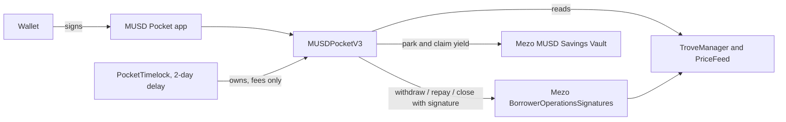

<p align="center"></p>

# MUSD Pocket

MUSD Pocket turns MUSD, Mezo's Bitcoin-backed dollar, into savings goals with a date. You can fill a goal from your wallet, borrow against your BTC straight into it, or let friends chip in. In Wave 3 the money in a goal can earn in Mezo's own MUSD Savings Vault while it waits, and a goal can pay down its owner's Mezo loan if BTC falls. The lock now lowers loan risk instead of adding to it.

This is our [AKINDO Mezo Buildathon](https://app.akindo.io/wave-hacks/OVOO0gdrVU8379D10) project for the Access & Distribution track.

Addresses, the live URL and the test counts live in [facts.json](facts.json). If a number here disagrees with that file, the file wins.

## Where to click

- Live app: https://musd-pocket-mezo.vercel.app
- What changed for the judges: [docs/JUDGE-FEEDBACK.md](docs/JUDGE-FEEDBACK.md) and [CHANGELOG.md](CHANGELOG.md)
- MUSD Pocket v3 on Mezo testnet (verified on Blockscout and Sourcify): [`0xF86c8ef87F617041BBbcF61EeBE34cB811E7616c`](https://explorer.test.mezo.org/address/0xF86c8ef87F617041BBbcF61EeBE34cB811E7616c)
- PocketTimelock, owner of v3, 2-day delay: [`0xb6790A383679A3364E656dAd1E8fCf4195f37990`](https://explorer.test.mezo.org/address/0xb6790A383679A3364E656dAd1E8fCf4195f37990)
- Mezo MUSD Savings Vault (sMUSD) that v3 uses on testnet: [`0x6f461c68B2c5492C0F5CCEc5a264d692aA7A8e16`](https://explorer.test.mezo.org/address/0x6f461c68B2c5492C0F5CCEc5a264d692aA7A8e16)
- v2 (Wave 2), still readable, goals there are untouched: [`0xEC03F758219746b6e773f107a05cF17b66E7D460`](https://explorer.test.mezo.org/address/0xEC03F758219746b6e773f107a05cF17b66E7D460)
- v1 (Wave 1), history only: [`0x2d5f1275ac326aE0253aAf1cF7b633f7Fec2A1C8`](https://explorer.test.mezo.org/address/0x2d5f1275ac326aE0253aAf1cF7b633f7Fec2A1C8)
- Demo video (Wave 2): https://youtu.be/eWAqu1FZ-40
- Deck (Wave 2): [docs/MUSD-Pocket-Wave2-Final.pdf](docs/MUSD-Pocket-Wave2-Final.pdf)

Mezo mainnet does not have a Pocket yet. The deploy is ready for the owner to run from their own wallet: [docs/DEPLOY_MAINNET.md](docs/DEPLOY_MAINNET.md).

## For judges: every Wave 2 ask and where it stands

Wave 2 scores: Mezo Integration 8, Product and Business 4, Technical 7, User Experience 7, Materials 7. Detail, commits and tests: [docs/JUDGE-FEEDBACK.md](docs/JUDGE-FEEDBACK.md).

| Ask | Status | Where |
|---|---|---|
| Put locked MUSD to work in the MUSD Savings Vault | Done on testnet | `setEarn`, `_park`, `_settle` in `MUSDPocketV3.sol` |
| A goal repays or closes its owner's loan in an emergency | Done on testnet, proven in fork tests | `emergencyRepay`, `emergencyClose` |
| No borrowing in Recovery Mode | Done, contract and app | `borrowToGoal` reverts `RecoveryModeActive`; app shows a banner |
| Minimum debt checked before a repay | Done, contract and app | `BelowMinNetDebt`, reads `minNetDebt()` live; the app checks first |
| Pending-rewards double count in the loan view | Done | `troveFromEntire` in `frontend/src/lib/mezo.ts` |
| Outside wallets that deposit and chip in | **Not met**: 2 outside wallets created goals, 0 deposits, 0 chip-ins | Counted live from the explorer in the Testers section |
| Mainnet | **Not deployed.** Ready for the owner to run from their own wallet | [docs/DEPLOY_MAINNET.md](docs/DEPLOY_MAINNET.md) |
| sMUSD gauge | Not used. Mezo has no sMUSD gauge | See JUDGE-FEEDBACK.md |
| Yield fee, Pocket Pro, embeddable widget | Planned, not built | [docs/BUSINESS.md](docs/BUSINESS.md) |

### How the parts fit



### Business model

One fee is live: 2% on leaving a goal early (capped at 5%). A fee on savings yield, an optional Pocket Pro plan and an embeddable widget are planned and are not built. Revenue is zero today and the projections are labelled as such. Read [docs/BUSINESS.md](docs/BUSINESS.md); the app shows the same thing in its "How it earns" section.

### Who builds it

A solo builder, Crypto boy (Cryptoboy_777 on AKINDO): contracts, the Mezo integration, product and design.

## What v3 does, using Mezo's own contracts

| Mezo primitive | What Pocket does with it |
|---|---|
| MUSD | Goals are held in MUSD. Deposits can use EIP-2612 permit. |
| BorrowerOperationsSignatures | `withdrawMUSDWithSignature` borrows straight into a goal (Wave 2). `repayMUSDWithSignature` and `closeTroveWithSignature` let a goal repay or close its owner's own loan (Wave 3). |
| MUSD Savings Vault (sMUSD) | A goal can switch on earning. Its MUSD goes into the vault and withdraw pays back principal plus the goal's share of the yield. |
| TroveManager | Live loan health, Recovery Mode check before every borrow, and the correct ICR math (no double counted pending rewards). |
| BorrowerOperations | Reads `minNetDebt()` live so a repay never tries to go below 1,800 MUSD. |
| PriceFeed | BTC price for the 150% borrow floor and the "at risk" line (200%). |

Rules worth knowing:

- Early unlock fee is 2% by default, capped at 5% in the contract, and stored on each goal when it is created. Chip-ins and on-time withdraws are free.
- Repaying a loan from a goal is free when the goal is unlocked, when the loan is below 200% collateral, or when Mezo is in Recovery Mode. Otherwise the goal's early-exit fee applies to the amount, so the repay path cannot be used to skip the lock.
- Borrow into a goal is refused in Recovery Mode, by the contract and by the app.
- Closing a whole loan from a goal is not possible in Recovery Mode. That is Mezo's own rule.
- Admin actions (fee level, fee claims) go through a public 2-day timelock. The admin can never move goal balances or earned yield.

## Design

Engraved light: banknote guilloche, bottle-green ink, champagne gold. Type is Gloock and Geist. Tokens are in `frontend/src/styles/tokens.css`; the Wave 3 parts are in `frontend/src/styles/wave3.css`.

## Setup

You need Foundry (we used 1.9.0), Node 22 and npm 10.

### Contracts

```bash
cd contracts
forge test
RUN_FORK=1 forge test --match-path 'test/*fork*'   # optional, reads Mezo testnet, broadcasts nothing
```

Test counts: 99 Foundry passed, 0 failed, 1 skipped, 64 Vitest, plus 8 fork tests against live Mezo testnet. The skipped Foundry test reads Mezo mainnet only when `MEZO_MAINNET_RPC` is set.

Static analysis: `slither .` output is in [docs/wave3/slither-v3.txt](docs/wave3/slither-v3.txt), with the findings we accept explained in [docs/JUDGE-FEEDBACK.md](docs/JUDGE-FEEDBACK.md#slither).

### Frontend

```bash
cd frontend
npm ci
npm test
npm run build
```

`npm ci` uses `frontend/.npmrc` (`legacy-peer-deps=true`) because a WalletConnect dependency asks for TypeScript 5 while this app uses TypeScript 7. The Vercel project uses Root Directory `frontend`.

## Network

Testnet, from [Mezo's getting started guide](https://mezo.org/docs/developers/getting-started/):

- Chain ID `31611`, RPC `https://rpc.test.mezo.org`, explorer https://explorer.test.mezo.org, faucet https://faucet.test.mezo.org
- MUSD `0x118917a40FAF1CD7a13dB0Ef56C86De7973Ac503` from the [contracts reference](https://mezo.org/docs/users/resources/contracts-reference/)
- sMUSD `0x6f461c68B2c5492C0F5CCEc5a264d692aA7A8e16`, which is what `PCV.feeRecipient()` returns on testnet

Mainnet (chain 31612) sMUSD is `0xb4D498029af77680cD1eF828b967f010d06C51CC`. It is listed in Mezo's documentation and `PCV.feeRecipient()` returns the same address on mainnet.

## Security

Our own review is in [docs/SECURITY_REVIEW.md](docs/SECURITY_REVIEW.md). It is not an independent audit.
