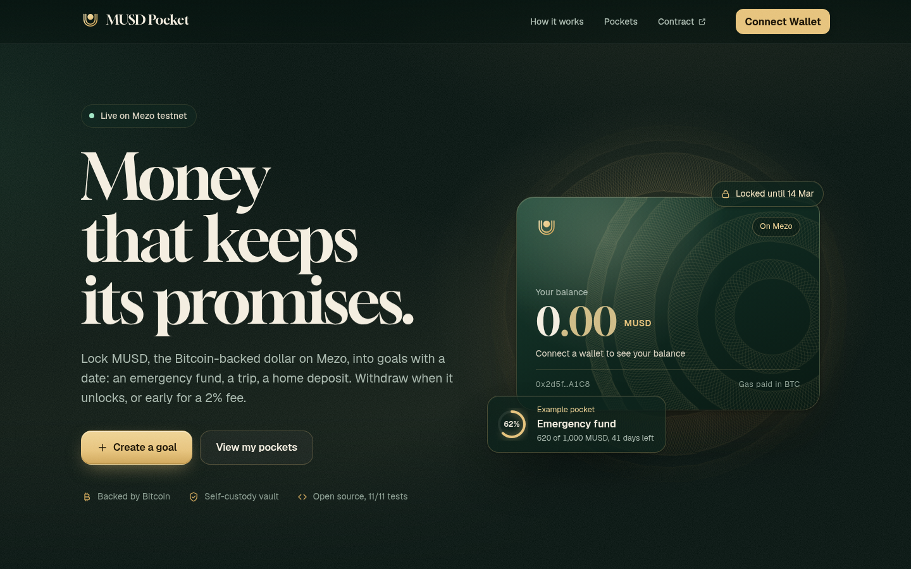
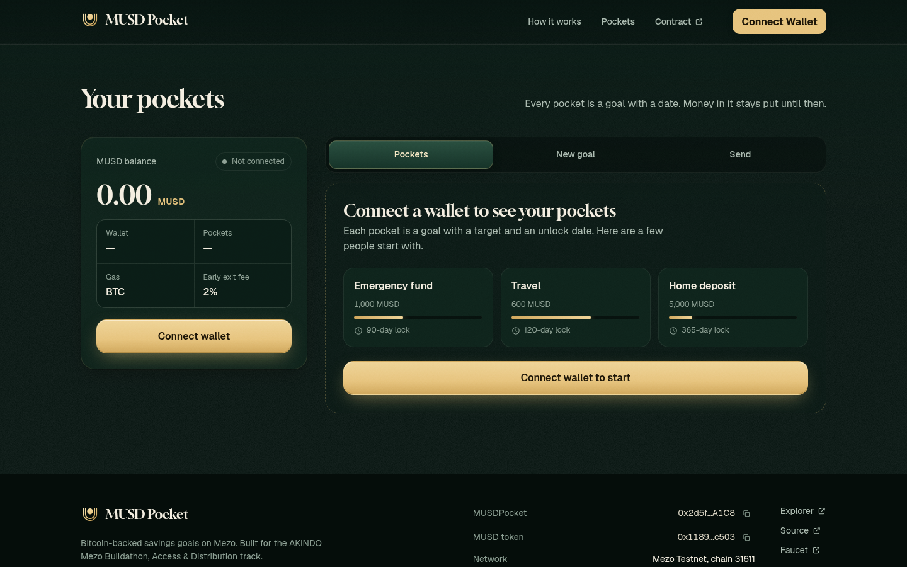
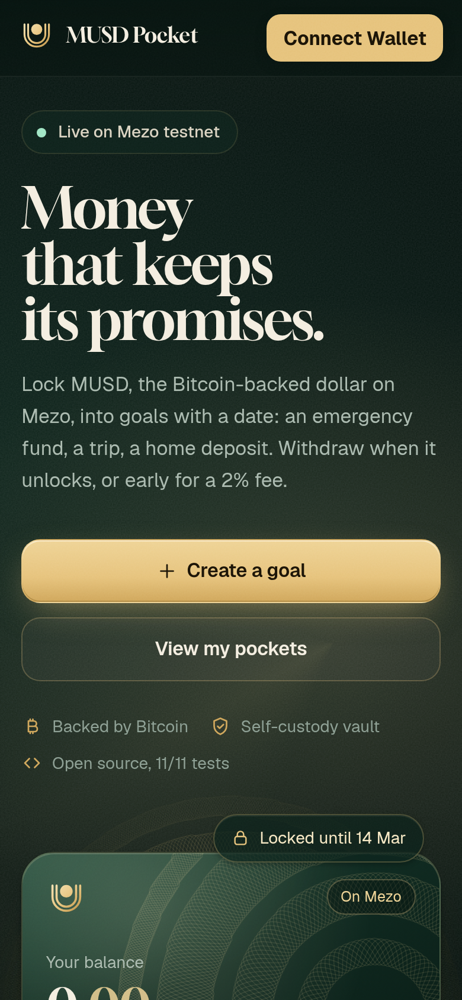
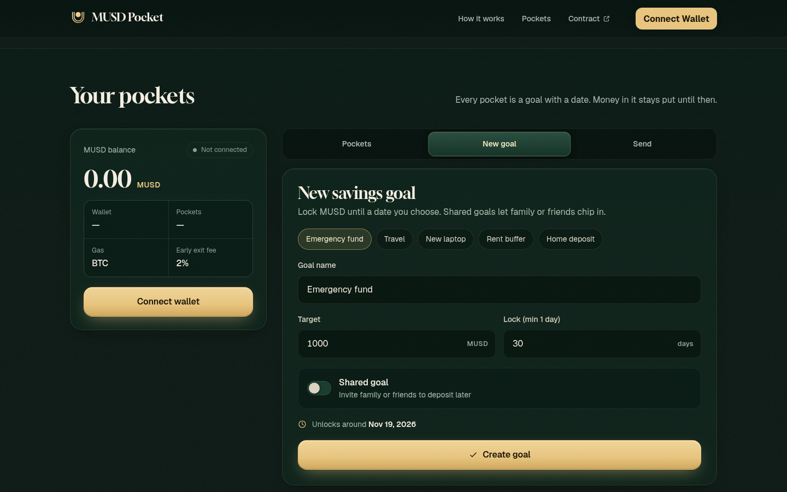
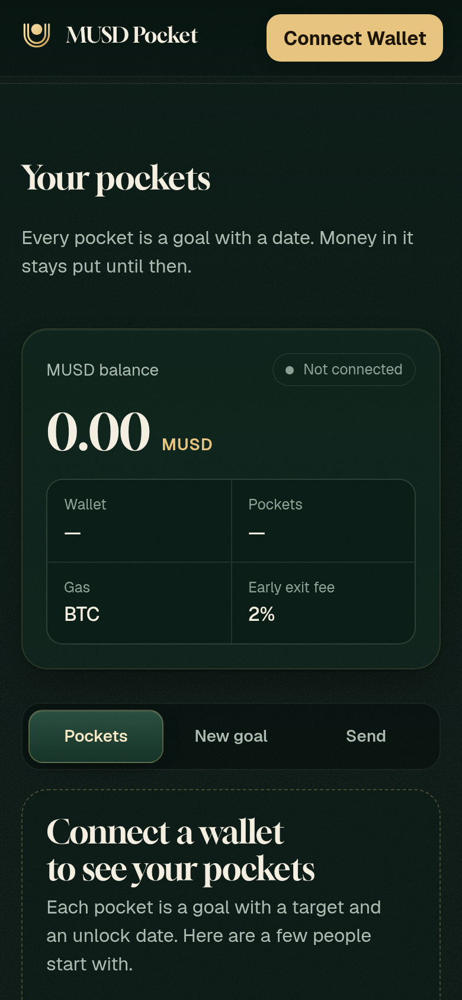
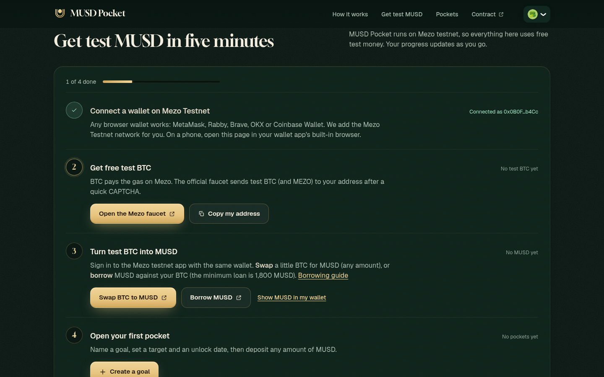
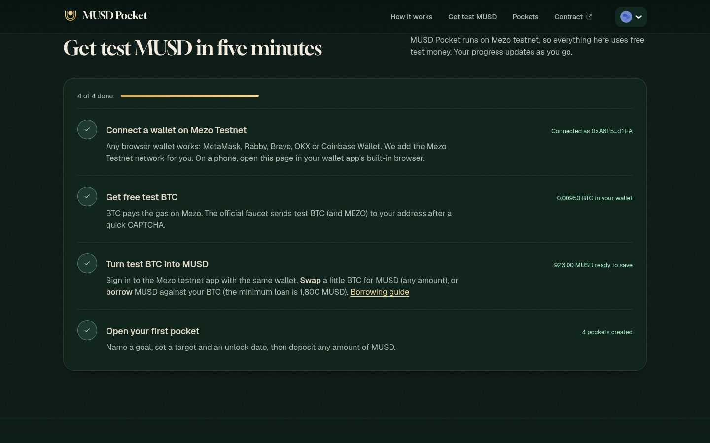
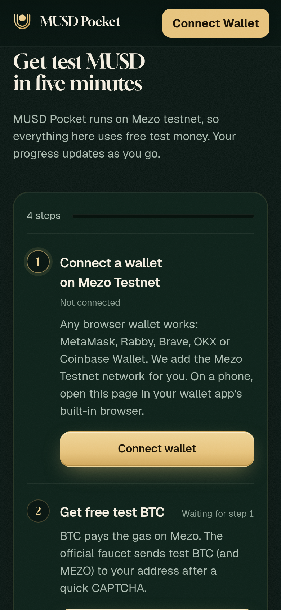

<p align="center"></p>

# MUSD Pocket

> **Money that keeps its promises.** Lock MUSD, Mezo's Bitcoin-backed dollar, into savings goals with a date. Withdraw on time, or early for a 2% fee. Send MUSD to anyone with an on-chain memo.

Global **goal savings + memo payments** app for [Mezo](https://mezo.org)’s Bitcoin-backed **MUSD**.  
Built for the [AKINDO Mezo Buildathon](https://app.akindo.io/wave-hacks/OVOO0gdrVU8379D10) · Access & Distribution track · `@Cryptoboy_777`.

**Proof it works**
- **Real on-chain activity:** [docs/onchain-activity.md](docs/onchain-activity.md) lists 19 transactions on Mezo testnet with explorer links:
  - borrowing MUSD against test BTC;
  - creating three goals (one of them shared), with deposits;
  - a second wallet contributing to the shared goal;
  - two memo payments;
  - an early withdrawal that paid the 2% fee.
- **Security review:** [docs/SECURITY_REVIEW.md](docs/SECURITY_REVIEW.md) covers Slither (9 results, 0 high) and a manual review, with each finding given a severity. 24/24 Foundry tests pass. The deployed bytecode matches this source, and the contract is verified on the explorer.
- **Onboarding for first-time users:** an in-app "Get test MUSD" guide with four steps (wallet → faucet → swap or borrow MUSD → first pocket). Each step checks off live from your wallet's balances.



## Design

**Art direction: "Engraved light."** The security engraving of banknotes and bond certificates (guilloche rosettes, double-line strokes) lit like a vault at night: bottle-green ink, champagne-gold light, one slowly turning engraved plate.
Type pairs Gloock (high-contrast engraved serif for headlines and balances) with Geist (precise UI sans, tabular figures); all colour, space, radius, depth and motion live in CSS tokens (`frontend/src/styles/tokens.css`).

**Logo.** Two engraved lines, the double stroke shared by currency signs and security print, form a pocket that cradles a coin; the gap around the coin is the lock. Files: `frontend/public/logo.svg`, `logo-mark.svg`, `logo-mono.svg`, `favicon.svg`, `docs/musd-pocket-icon.png`.

| Desktop app | Mobile |
| --- | --- |
|  |  |
|  |  |

Before the redesign: [`docs/redesign-before.png`](docs/redesign-before.png).

### Onboarding: "Get test MUSD"

| New wallet (desktop) | Finished (desktop, real testnet data) | Mobile |
| --- | --- | --- |
|  |  |  |

Empty states point back to the guide: [`docs/empty-state-desktop.png`](docs/empty-state-desktop.png). Real pockets from the demo wallet: [`docs/pockets-real-desktop.png`](docs/pockets-real-desktop.png).
The "connected" screenshots use a read-only viewer wallet that loads public on-chain data for an address. It cannot sign and it is not part of the app.

## Links

- **Live demo:** https://cyptoboy777.github.io/musd-pocket/
- **MUSDPocket contract (Mezo testnet):** [`0x2d5f1275ac326aE0253aAf1cF7b633f7Fec2A1C8`](https://explorer.test.mezo.org/address/0x2d5f1275ac326aE0253aAf1cF7b633f7Fec2A1C8)
- **Deploy tx:** [`0x98181dcd…b61df6`](https://explorer.test.mezo.org/tx/0x98181dcdda80939a99ce5dbd33be70cc4081356f50561d9be46545b0eab61df6)
- **Repo:** https://github.com/Cyptoboy777/musd-pocket
- **On-chain activity:** [docs/onchain-activity.md](docs/onchain-activity.md) · **Security review:** [docs/SECURITY_REVIEW.md](docs/SECURITY_REVIEW.md)

## Quick start

### Contracts (Foundry)

```bash
export PATH="$HOME/.foundry/bin:$PATH"
cd contracts
forge test -vv   # 24 tests: 11 core + 13 security (see docs/SECURITY_REVIEW.md)
```

Deploy to Mezo testnet (needs BTC gas on deployer):

```bash
set -a && source ../.env && set +a
forge script script/Deploy.s.sol:Deploy --rpc-url "$MEZO_TESTNET_RPC" --broadcast -vvvv
```

The frontend defaults to the deployed address `0x2d5f1275ac326aE0253aAf1cF7b633f7Fec2A1C8`; override with `VITE_POCKET_ADDRESS` in `frontend/.env`.

### Frontend

```bash
cd frontend
npm install
npm run dev      # http://localhost:5173
npm run build
npm run preview
```

**Wallets.** `VITE_WC_PROJECT_ID` is the public Reown (WalletConnect) project id. The hosted build sets it in `.github/workflows/pages.yml`, which enables mobile QR and deep-link wallets (Rainbow, Base, MetaMask, WalletConnect). If the id is unset, the app falls back to browser wallets only (EIP-6963 injected and Coinbase Wallet) rather than a placeholder id. `package.json` pins `qr@0.5.5` under `cuer`, because `qr` 0.7 throws "invalid border=0" when RainbowKit renders the WalletConnect QR code.

The hosted build is deployed to GitHub Pages by `.github/workflows/pages.yml` on every push to `master` that touches `frontend/` (Vite `base` = `/musd-pocket/`).

## Network

- Chain ID `31611` · RPC `https://rpc.test.mezo.org`
- MUSD `0x118917a40FAF1CD7a13dB0Ef56C86De7973Ac503`
- MUSDPocket `0x2d5f1275ac326aE0253aAf1cF7b633f7Fec2A1C8`
- Explorer https://explorer.test.mezo.org
- Faucet https://faucet.test.mezo.org (test BTC and MEZO, CAPTCHA)
- Get MUSD: swap BTC→MUSD at https://testnet.mezo.org/feature/swap, or borrow at https://testnet.mezo.org/feature/borrow (minimum loan 1,800 MUSD; [guide](https://mezo.org/docs/users/borrow/mint-musd/))

See [NOTES.md](./NOTES.md) and [SUBMISSION.md](./SUBMISSION.md).

## Pitch
- Pitch deck (PDF): [docs/MUSD-Pocket-Pitch-Deck.pdf](docs/MUSD-Pocket-Pitch-Deck.pdf)
- Pitch video (2 min): https://youtu.be/v9pkZ0W2YDE
