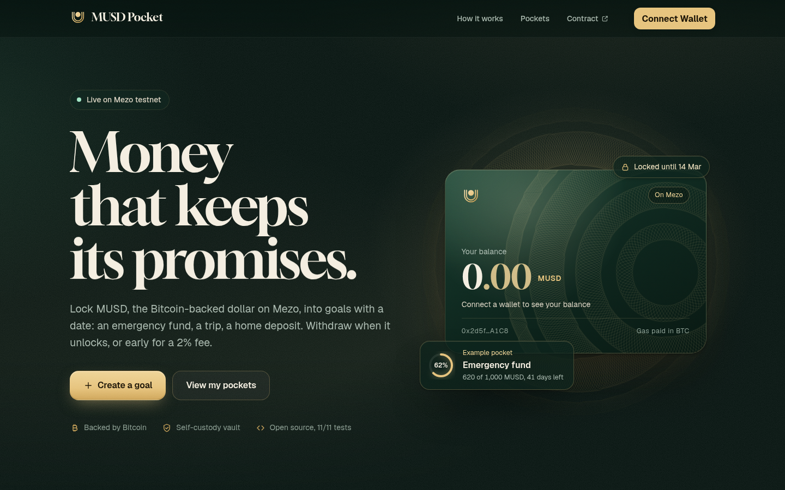

<p align="center"></p>

# MUSD Pocket

> Money that keeps its promises. Lock MUSD, Mezo's Bitcoin-backed dollar, into savings goals with a date. Withdraw on time, or early for a 2% fee. Borrow against your BTC straight into a goal. Send MUSD to anyone with an on-chain memo.

India-first **goal savings + memo payments** app for [Mezo](https://mezo.org)’s Bitcoin-backed **MUSD**.
Built for the [AKINDO Mezo Buildathon](https://app.akindo.io/wave-hacks/OVOO0gdrVU8379D10) · Access & Distribution track · `@Cryptoboy_777`.

**Everything below is Mezo testnet (chain 31611) unless a line says mainnet.**

## Wave 2

- **Live app (primary):** https://musd-pocket-mezo.vercel.app
- Also: https://musd-pocket-wheat.vercel.app · GitHub Pages: https://cyptoboy777.github.io/musd-pocket/
- **Do not use** `musd-pocket.vercel.app` (another team's app).
- **MUSDPocket v2 (verified):** [`0xEC03F758219746b6e773f107a05cF17b66E7D460`](https://explorer.test.mezo.org/address/0xEC03F758219746b6e773f107a05cF17b66E7D460) · deploy [`0xa58ddba9…64f6`](https://explorer.test.mezo.org/tx/0xa58ddba9e9c1fb87ee211016f729491806bf74e06ce23fa38a97fe0d092d64f6)
- **Borrow-into-goal:** one Mezo `WithdrawMUSD` signature, recipient = Pocket; live ICR, liquidation price, and a max-safe recompute right before send. Contract reverts under 150% ICR.
- **Loan readiness:** Mezo minimum is 1,800 MUSD principal + 200 MUSD gas deposit (about 2,000 MUSD total debt at open). Small savers keep the plain MUSD deposit path; borrow-into-goal only enables with a valid trove.
- **Savings Vault (sMUSD):** documented on mainnet at `0xb4D498029af77680cD1eF828b967f010d06C51CC`. `eth_getCode` on that address on testnet 31611 returns empty, so the app labels it documented-but-not-live. sMUSD does **not** raise trove ICR.
- **Proof:** I only have my own test wallets so far. The in-app Proof section lists them with explorer tx links and labels them as my own (deployer, Wave 1 second key, and three Wave 2 generated wallets funded from the deployer). No third-party users yet. Details in [docs/onchain-activity.md](docs/onchain-activity.md).



## Design

**Art direction: "Engraved light."** Banknote-style guilloche, bottle-green ink, champagne-gold light.
Type: Gloock + Geist. Tokens in `frontend/src/styles/tokens.css`.

## Links

- **Live demo:** https://musd-pocket-mezo.vercel.app
- **MUSDPocket v2 (Mezo testnet, verified):** [`0xEC03…D460`](https://explorer.test.mezo.org/address/0xEC03F758219746b6e773f107a05cF17b66E7D460)
- **v1 (Wave 1):** [`0x2d5f…A1C8`](https://explorer.test.mezo.org/address/0x2d5f1275ac326aE0253aAf1cF7b633f7Fec2A1C8)
- **Repo:** https://github.com/Cyptoboy777/musd-pocket
- **On-chain activity:** [docs/onchain-activity.md](docs/onchain-activity.md) · **Security:** [docs/SECURITY_REVIEW.md](docs/SECURITY_REVIEW.md)

## Quick start

### Contracts (Foundry)

```bash
export PATH="$HOME/.foundry/bin:$PATH"
cd contracts
forge test -vv
# bytecode match for the deployed v2:
# forge verify-bytecode 0xEC03F758219746b6e773f107a05cF17b66E7D460 src/MUSDPocketV2.sol:MUSDPocketV2 \
#   --constructor-args <MUSD> <BOS> <TroveManager> <PriceFeed> <owner> --rpc-url https://rpc.test.mezo.org
```

### Frontend

```bash
cd frontend
npm install
npm run build
```

Hosted on Vercel with Root Directory `frontend` (see `frontend/vercel.json`). Pages workflow still builds with `VITE_BASE=/musd-pocket/`.

## Network (testnet)

- Chain ID `31611` · RPC `https://rpc.test.mezo.org`
- MUSD `0x118917a40FAF1CD7a13dB0Ef56C86De7973Ac503` (18 decimals)
- MUSDPocket v2 `0xEC03F758219746b6e773f107a05cF17b66E7D460`
- Explorer https://explorer.test.mezo.org
- Faucet https://faucet.test.mezo.org
- Borrow https://testnet.mezo.org/feature/borrow (min 1,800 MUSD + 200 gas deposit)

## Pitch

- Pitch deck (PDF): [docs/MUSD-Pocket-Pitch-Deck.pdf](docs/MUSD-Pocket-Pitch-Deck.pdf)
- Pitch video (2 min): https://youtu.be/v9pkZ0W2YDE
